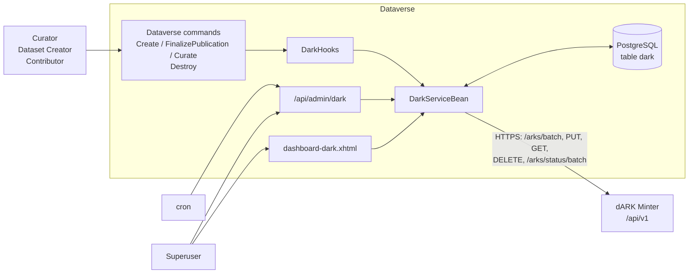
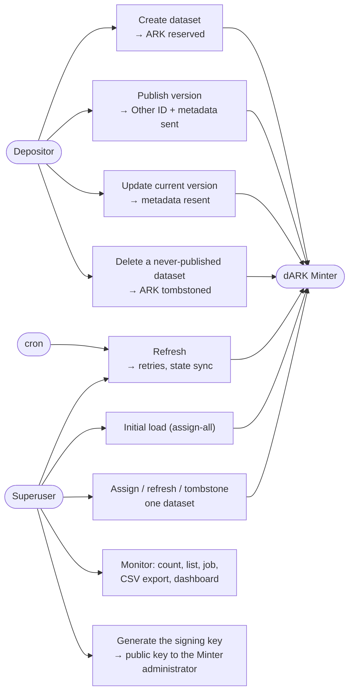
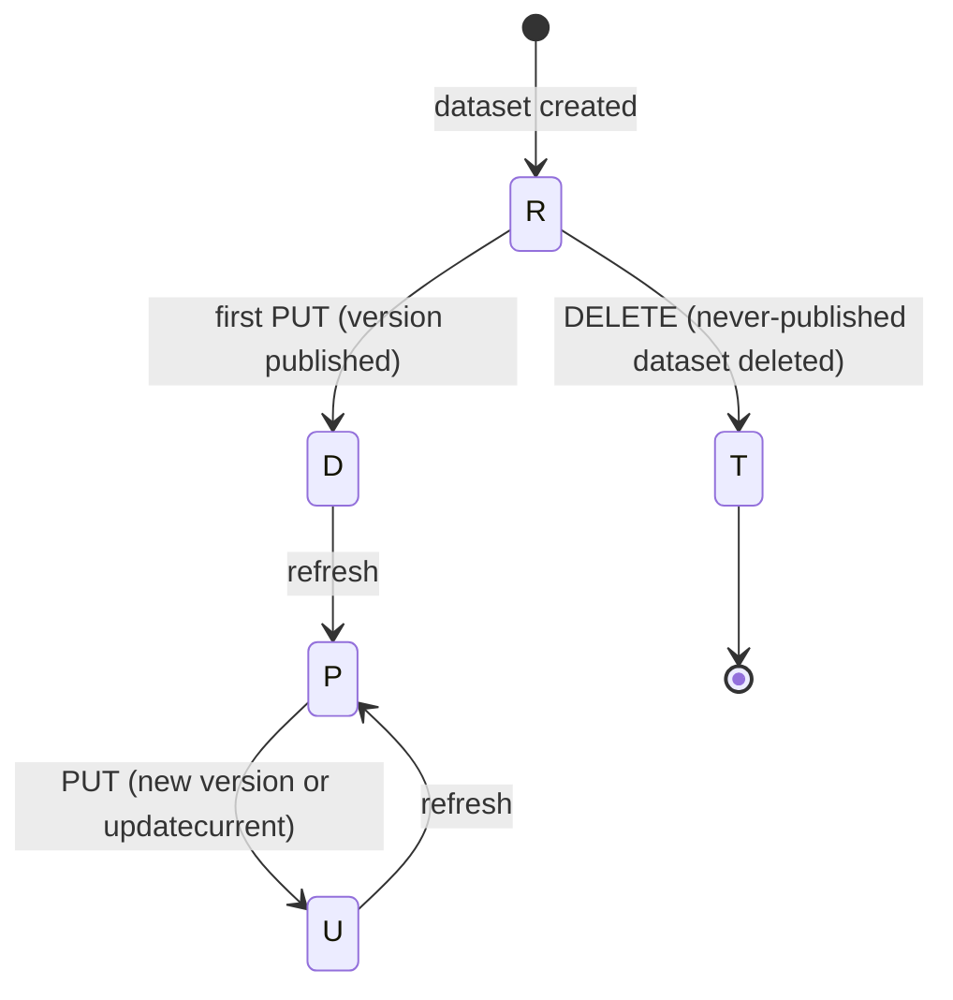
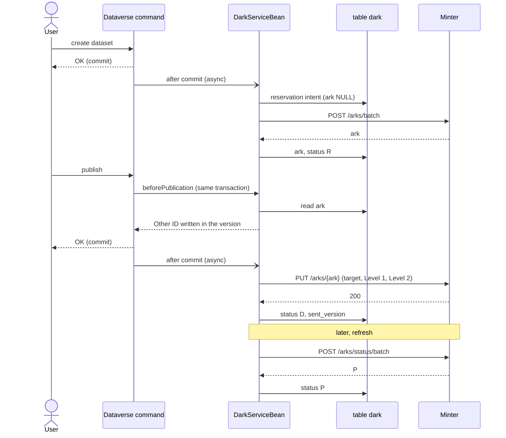

# dARK integration for Dataverse: technical documentation

Fork of Dataverse 6.12.1 (branch `feature/dark`) that assigns a **dARK** identifier to every local dataset.

## 1. Scope

- Every **local** dataset gets a dARK, whatever its PID type. **Harvested** datasets are excluded.
- The dARK is written to the dataset's **Other ID** field (`otherIdAgency` = `dARK`, `otherIdValue` = `ark:<NAAN>/<id>`).
- Everything is off unless `dataverse.dark.enabled=true`. Disabled, Dataverse behaves exactly as upstream.
- A connection issue with the Minter never prevents creation, publication, etc. 
- No HTTP call to the Minter runs inside a Dataverse command transaction. Calls run after the commit, in `@Asynchronous` EJB methods.
- Every request that modifies data in the Minter is signed with this installation's Ed25519 key (section 7.5).

## 2. Architecture



| Component | Location | Role |
|---|---|---|
| Hooks | Dataverse commands | Call `DarkHooks`. |
| `DarkServiceBean` | `edu.harvard.iq.dataverse.dark` | Lifecycle: reservation, metadata, Other ID, tombstones, refresh and assign-all jobs. Runs without a transaction. |
| `DarkRepository` | `edu.harvard.iq.dataverse.dark` | Every transaction on table `dark`. |
| `DarkReportBean` | `edu.harvard.iq.dataverse.dark` | Counts and lists for the admin API and the dashboard. |
| `DarkClient` | `edu.harvard.iq.dataverse.dark` | HTTP client of the Minter (`java.net.http`). |
| `DarkSigner`, `DarkKeyStore` | `edu.harvard.iq.dataverse.dark` | DARK2 signature of a request. |
| `DarkMetadataBuilder` | `edu.harvard.iq.dataverse.dark` | Level 1 (JSON) and Level 2 (`oai_datacite` XML) metadata. |
| `Dark` (entity) | `edu.harvard.iq.dataverse.dark` | Table `dark`. |
| Admin API | `edu.harvard.iq.dataverse.api.Dark` | `/api/admin/dark/*`. |
| Dashboard | `dashboard-dark.xhtml`, `DarkDashboardPage` | Superuser page. |
| Migration | `V6.12.1.1.sql` | Foreign key and indexes of table `dark`. |

### Hook points

| Dataverse command | Hook | Effect |
|---|---|---|
| `AbstractCreateDatasetCommand.onSuccess` (create, import) | `datasetCreated` | Reserve an ARK after commit (`POST /arks/batch`). |
| `FinalizeDatasetPublicationCommand.execute` | `beforePublication` | Write the Other ID into the version being published, inside the transaction. Reads the local table only; no HTTP; never throws. |
| `FinalizeDatasetPublicationCommand.onSuccess` | `datasetPublished` | Send metadata after commit (`PUT /arks/{ark}`). |
| `CuratePublishedDatasetVersionCommand.onSuccess` (`updatecurrent`) | `datasetCurated` | Resend metadata after commit. |
| `DestroyDatasetCommand.onSuccess` (destroy, and delete of a never-published dataset) | `datasetDestroyed` | Tombstone. |

Deaccessioning has no hook: a deaccessioned dataset keeps its ARK (see 4.1).

## 3. Use cases




## 4. Lifecycle

### 4.1 States

States are the Minter's, stored locally as `dark.status`.



| Code | Name | Meaning |
|---|---|---|
| `R` | RESERVED | ARK reserved, it does not resolve. |
| `D` | DRAFT | First metadata. |
| `U` | UPDATE | Published ARK with new metadata . |
| `P` | PUBLISHED | Published and resolvable. |
| `T` | TOMBSTONE |  |

Deaccessioning never tombstones, even if every version is deaccessioned: the dataset still exists and can be published again, and the metadata of the new version is then sent with the normal flow.


### 4.2 Create and publish




## 5. Admin API

Base path: `/api/admin/dark`. Like the rest of `/api/admin`, it has no authentication of its own: it is protected by `dataverse.api.blocked.endpoints` / `dataverse.api.blocked.policy`. 

| Method | Path | Parameters | Description |
|---|---|---|---|
| `POST` | `/refresh` | — | Starts the refresh job. |
| `POST` | `/refresh/{id}` | — | Refreshes one dataset (not a background job) and returns its row. |
| `POST` | `/assign/{id}` | — | Assigns or retries one dataset: reserves if needed; if it is released, writes the Other ID (`updatecurrent`) and sends the metadata. Returns its row. |
| `POST` | `/assign-all` | `limit` (default `0` = all) | Starts the job that assigns a dARK to local eligible datasets without a row, in batches: initial load, and daily catch-up (section 7.4). |
| `POST` | `/tombstone/{id}` | — | Tombstone the dataset's ARK. |
| `POST` | `/key` | `replace` (default `false`) | Generates the signing key (section 7.5). `409` if one exists; `replace=true` only while dARK is disabled. |
| `GET` | `/key` | — | Public key, its id, and whether the Minter has the authority active and the NAAN authorized (`minter.authorityActive`, `minter.naanAuthorized`). If the Minter cannot be asked, the key is still returned, with the reason in `minter.error`. `404` without a key; `400` if `key-directory` is not set. |
| `GET` | `/count` | — | `enabled`, `total`, `byStatus` (R, D, U, P, T), `stuck`, `withErrors`, `missing`, `notEligible`. |
| `GET` | `/job` | — | State and counters of the last job (kept in memory; `404` after a restart). |
| `GET` | `/` | `view` (`assigned` \| `missing`), `ark`, `status` (R/D/U/P/T), `datasetId`, `errorsOnly`, `page` (from 0), `size` (default 25, max 100), `sort` (`createdAt` \| `updatedAt`), `direction` (`ASC` \| `DESC`) | Paged list. `assigned`: rows of `dark`. `missing`: local datasets without a row (only `datasetId`, `page`, `size` apply). |
| `GET` | `/export` | same filters as `view=assigned` | CSV `dark-registry.csv`, up to 100,000 rows. |


## 6. Minter calls

| Operation | Request | Notes |
|---|---|---|
| Reserve | `POST /arks/batch` | `authority_id`, `naan`, `items[].client_item_id`. Up to `batch-size` items. |
| Send metadata | `PUT /arks/{ark}` | `authority_id`, `target`, `minimal_metadata` (Level 1 JSON), `original_metadata` (Level 2 XML), `metadata_schema` = `oai_datacite`, `metadata_media_type` = `application/xml`. `409` = in progress (see below). |
| Status | `POST /arks/status/batch` | Falls back to `GET /arks/{ark}` on `404`/`405`. |
| Tombstone | `DELETE /arks/{ark}` | A `409` (already tombstoned, or locked) is confirmed with `GET`. |


Headers on every call: `Accept`/`Content-Type: application/json` and `X-DARK-Authority-Id: <authority-id>`. Reserve, send metadata and tombstone are also signed (section 7.5); status and the other reads are not, as the Minter specifies. Redirects are never followed.

`client_item_id` is the full PID: DOI and Handle lower-cased (`doi:`, `hdl:`); PermaLink and plugin PIDs unchanged (they may be case-sensitive). Maximum 100 characters; longer PIDs are not eligible.

`target`: with `target=pid`, the PID resolver URL (`https://doi.org/…`, `https://hdl.handle.net/…`, or the PermaLink URL Dataverse builds); with `target=landing`, `<dataverse.siteUrl>/dataset.xhtml?persistentId=<PID>`.

Level 1 fields: `ark`, `title`, `authors`, `creator`, `date` and `year` (release date of that version, UTC), `publisher`, `resource_type` (`Dataset`), `language`, `abstract`, `rights` (license name, or `Custom Dataset Terms`), `subjects`, `alternate_identifiers` (PID), `alternate_urls` (landing page), `original_metadata`. Level 2 is the output of Dataverse's `oai_datacite` exporter (`OpenAireExportUtil`) for the latest released version, generated at send time. Metadata is always taken from the **latest released version**.

## 7. Configuration

### 7.1 Settings

MicroProfile Config: each setting can be a JVM option (`-Ddataverse.dark.…`) or an environment variable (upper case, `.` and `-` replaced by `_`).

| JVM option | Environment variable | Default | Description |
|---|---|---|---|
| `dataverse.dark.enabled` | `DATAVERSE_DARK_ENABLED` | `false` | Enables the integration. It stays inactive, with a warning in the log, while `minter-url`, `authority-id`, `naan` or `key-directory` is missing, the key has not been generated, or `minter-url` is not HTTPS. |
| `dataverse.dark.minter-url` | `DATAVERSE_DARK_MINTER_URL` | — | Minter API base URL. HTTPS; `http://` is only accepted for `localhost`, or with `allow-http`. |
| `dataverse.dark.authority-id` | `DATAVERSE_DARK_AUTHORITY_ID` | — | Authority UUID registered in the Minter. |
| `dataverse.dark.naan` | `DATAVERSE_DARK_NAAN` | — | NAAN. |
| `dataverse.dark.key-directory` | `DATAVERSE_DARK_KEY_DIRECTORY` | — | Directory of the signing key (section 7.5). On a persistent volume, outside any web-served or config-source directory. |
| `dataverse.dark.allow-http` | `DATAVERSE_DARK_ALLOW_HTTP` | `false` | Development only: accept an `http://` Minter that is not `localhost`. |
| `dataverse.dark.publisher` | `DATAVERSE_DARK_PUBLISHER` | root collection name | Level 1 `publisher`. Level 2 uses `:InstallationName` (or the root collection name); set both to the same value for consistency. |
| `dataverse.dark.other-id-agency` | `DATAVERSE_DARK_OTHER_ID_AGENCY` | `dARK` | `otherIdAgency` written with the ARK. |
| `dataverse.dark.target` | `DATAVERSE_DARK_TARGET` | `pid` | `pid` or `landing`. |
| `dataverse.dark.batch-size` | `DATAVERSE_DARK_BATCH_SIZE` | `100` | Items per batch call; capped at 100. |
| `dataverse.dark.max-attempts` | `DATAVERSE_DARK_MAX_ATTEMPTS` | `3` | Consecutive failures of a row before it is stuck and retried only once a day (section 4.3). |
| `dataverse.dark.http-timeout-seconds` | `DATAVERSE_DARK_HTTP_TIMEOUT_SECONDS` | `30` | Connect and response timeout of each Minter call. The Minter guide uses `90` in production, because a reservation may take long. |


Changing them requires recreating the container (environment variables) or restarting Payara (JVM options).

### 7.2 Docker Compose

Values in `.env`:

```bash
DARK_ENABLED=false   # true only after the Minter administrator registered the key (section 7.5)
DARK_MINTER_URL=https://<minter-host>/api/v1
DARK_NAAN=<naan>
DARK_AUTHORITY_ID=<authority-uuid>
DARK_KEY_DIRECTORY=/dv/keys/dark
DARK_PUBLISHER=<repository name>
```

In `compose.yml`, in the `environment` of the Dataverse service:

```yaml
services:
  dataverse:
    environment:
      DATAVERSE_DARK_ENABLED: ${DARK_ENABLED:-false}
      DATAVERSE_DARK_MINTER_URL: ${DARK_MINTER_URL}
      DATAVERSE_DARK_NAAN: ${DARK_NAAN}
      DATAVERSE_DARK_AUTHORITY_ID: ${DARK_AUTHORITY_ID}
      DATAVERSE_DARK_KEY_DIRECTORY: ${DARK_KEY_DIRECTORY}
      DATAVERSE_DARK_PUBLISHER: ${DARK_PUBLISHER}
      # Optional; values shown are the defaults:
      # DATAVERSE_DARK_TARGET: "pid"
      # DATAVERSE_DARK_OTHER_ID_AGENCY: "dARK"
      # DATAVERSE_DARK_BATCH_SIZE: "100"
      # DATAVERSE_DARK_MAX_ATTEMPTS: "20"
      # DATAVERSE_DARK_HTTP_TIMEOUT_SECONDS: "30"
```

Apply with `docker compose up -d` (Compose recreates the container when its environment changes). Check:

```bash
curl -s http://localhost:8080/api/admin/dark/count
```

`"enabled": true` confirms the configuration is complete and the key exists.

### 7.3 Admin API protection

`/api/admin` (which includes `/api/admin/dark`) must be blocked before enabling dARK in production.

- Classic installer: already restricted to localhost (`localhost-only`). Nothing to do; run the cron on the same host.
- Containers: it depends on the deployment. 

### 7.4 Cron

Two jobs:

| Job | Suggested schedule | Purpose |
|---|---|---|
| `refresh` | Every 15 minutes (`*/15`) | Retries, state sync with the Minter, pending versions, tombstones (section 4.3). |
| `assign-all` | Once a day, example at 02:07 | Datasets that have no row in `dark`: created while dARK was disabled, or whose reservation was lost because the server stopped right after the dataset was created. Published ones receive the Other ID through `updatecurrent`. |

### 7.5 Request signing (DARK2)

The Minter authenticates each modification with an Ed25519 signature; there is no login or token. Dataverse generates the key pair and keeps the private key; the Minter administrator registers the public key for the authority.

First setup, with `dataverse.dark.enabled=false`:

1. Set `minter-url`, `authority-id`, `naan` and `key-directory`, and start Dataverse.
2. Generate the key. The answer has only the public key and its id:

   ```bash
   curl -s -X POST http://localhost:8080/api/admin/dark/key
   ```

3. Give `publicKey` (and `keyId`) to the Minter administrator, and wait for the confirmation.
4. Check what the Minter says about the authority (`minter.authorityActive`, `minter.naanAuthorized`):

   ```bash
   curl -s http://localhost:8080/api/admin/dark/key
   ```

5. Set `dataverse.dark.enabled=true` and restart. 

To replace the key: set `dataverse.dark.enabled=false`, `POST /api/admin/dark/key?replace=true`, and repeat steps 3 to 5. The old key is deleted. 

Custody of the key:

- `key-directory` holds `private.pk8` and `public.der`. Dataverse creates the directory and the files itself, readable only by the user that runs it (`rwx------`, `rw-------`). In the container image that user is `payara`, and `/dv/keys/dark` is on the data volume.
- Before every signature Dataverse checks that they are regular files.
- Back up `key-directory` as a secret.


## 8. Database

Table `dark` is created on deployment from the `Dark` entity, as Dataverse does for every new table. Flyway migration `V6.12.1.1.sql` adds what the entity cannot declare: the foreign key with `ON DELETE SET NULL` and the indexes.

Schema changes follow the Dataverse convention for SQL upgrade scripts.

| Column | Purpose |
|---|---|
| `id` | Identity. |
| `dataset_id` | FK to `dvobject(id)`. |
| `client_item_id` | Normalized PID sent to the Minter; indexed. Locates the row after a destroy. |
| `ark` | Compact ARK (`ark:<NAAN>/<id>`); unique; NULL while the reservation is pending. |
| `status` | `R`, `D`, `U`, `P`, `T`. |
| `target` | Target last reported by the Minter. |
| `sent_version`, `sent_dataset_version_id`, `sent_revision` | Version, version id and optimistic-lock revision of the last metadata sent. A mismatch with the latest released version means a resend is pending (this covers `updatecurrent`, which keeps the version number). |
| `attempts` | Consecutive failures (section 4.3); 0 after a success. |
| `other_id_attempts` | Consecutive failed automatic `updatecurrent` runs (max 3). |
| `last_error` | Last error, or NULL. Prefixes: `STUCK:` (status checks exhausted), `TOMBSTONE:` (tombstone not applied yet), `OTHER_ID:` (`updatecurrent` failed, or its 3 automatic retries are used up), `UNEXPECTED:` (failure a job did not expect; see section 9). No prefix: error returned by the Minter or connection failure. |
| `tombstone_requested` | Set after the Minter confirms it (status T). |
| `reservation_token`, `reservation_lease_until` | Claim of a pending reservation, so two processes do not reserve the same row. |
| `metadata_cid`, `level1_cid`, `level2_cid` | CIDs reported by the Minter. |
| `row_version`, `created_at`, `updated_at` | Optimistic locking and timestamps (UTC, the JVM time zone of the container). |


## 9. Tests

| Tests | Needs | Command |
|---|---|---|
| Unit (`Dark*Test`) | Nothing | `mvn test -Dtest='Dark*Test'` |
| API (`DarkIT`) | A running Dataverse | `mvn test -Dtest=DarkIT -Ddataverse.test.baseurl=http://localhost:8080` |
| Full lifecycle (`DarkIT.lifecycleAgainstMinter`) | dARK enabled against a Minter | add `-Ddark.it.e2e=true` |
