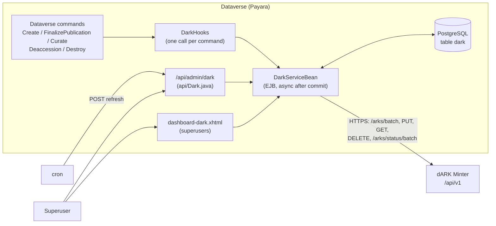
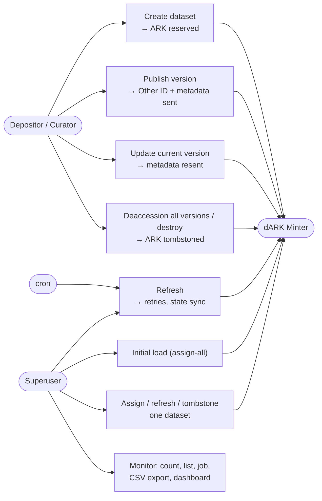
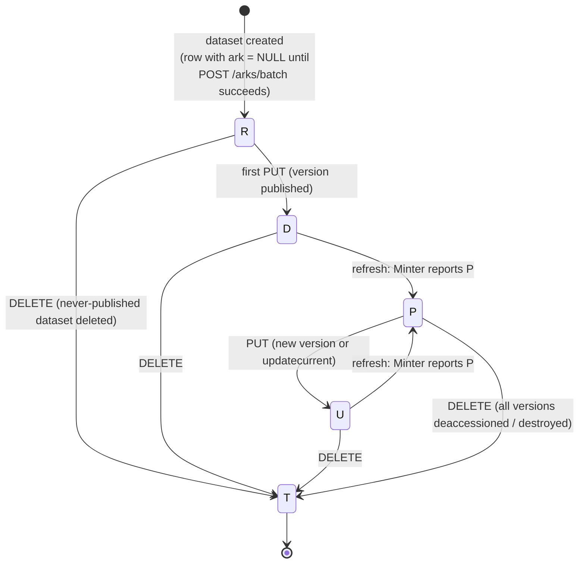
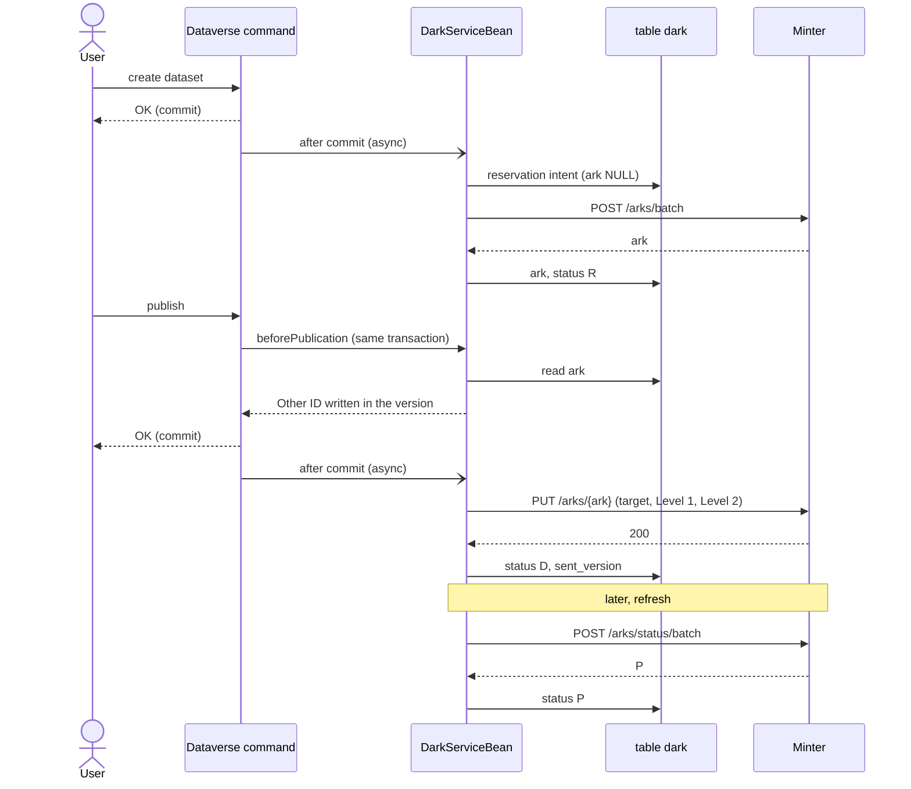
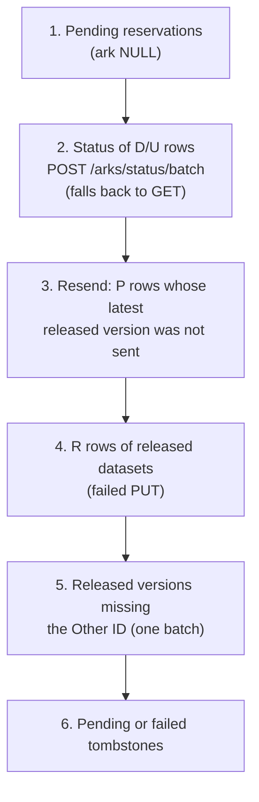

# dARK integration for Dataverse: technical documentation

Fork of Dataverse 6.12.1 (branch `feature/dark`) that assigns a **dARK** identifier to every local dataset.

## 1. Scope

- Every **local** dataset gets a dARK, whatever its PID type (DOI, Handle, PermaLink, PID plugins). **Harvested** datasets are excluded.
- The dARK is written to the dataset's **Other ID** field (`otherIdAgency` = `dARK`, `otherIdValue` = `ark:<NAAN>/<id>`).
- Everything is off unless `dataverse.dark.enabled=true`. Disabled, Dataverse behaves exactly as upstream.
- A connection issue with the Minter never prevents creation, publication, etc. Failed calls are recorded in the `dark` table and retried by the refresh process.
- No HTTP call to the Minter runs inside a Dataverse command transaction. Calls run after the commit, in `@Asynchronous` EJB methods.

## 2. Architecture



| Component | Location | Role |
|---|---|---|
| Hooks | 5 Dataverse commands, one line each | Call `DarkHooks`. They do nothing if dARK is disabled or the dataset is harvested. |
| `DarkServiceBean` | `edu.harvard.iq.dataverse.dark` | Reservation, metadata submission, Other ID, tombstones, refresh, assign, counts. |
| `DarkClient` | `edu.harvard.iq.dataverse.dark` | HTTP client of the Minter (`java.net.http`). |
| `DarkMetadataBuilder` | `edu.harvard.iq.dataverse.dark` | Level 1 (JSON) and Level 2 (`oai_datacite` XML) metadata. |
| `Dark` (entity) | `edu.harvard.iq.dataverse.dark` | Table `dark`. |
| Admin API | `edu.harvard.iq.dataverse.api.Dark` | `/api/admin/dark/*`. |
| Dashboard | `dashboard-dark.xhtml`, `DarkDashboardPage` | Superuser page. |
| Migration | `V6.11.0.1.1__dark.sql` | Creates table `dark`. |

### Hook points

| Dataverse command | Hook | Effect |
|---|---|---|
| `AbstractCreateDatasetCommand.onSuccess` (create, import) | `datasetCreated` | Reserve an ARK after commit (`POST /arks/batch`). |
| `FinalizeDatasetPublicationCommand.execute` | `beforePublication` | Write the Other ID into the version being published, inside the transaction. Reads the local table only; no HTTP; never throws. |
| `FinalizeDatasetPublicationCommand.onSuccess` | `datasetPublished` | Send metadata after commit (`PUT /arks/{ark}`). |
| `CuratePublishedDatasetVersionCommand.onSuccess` (`updatecurrent`) | `datasetCurated` | Resend metadata after commit. |
| `DeaccessionDatasetVersionCommand.onSuccess` | `datasetDeaccessioned` | Tombstone if no released version remains. |
| `DestroyDatasetCommand.onSuccess` (destroy, and delete of a never-published dataset) | `datasetDestroyed` | Tombstone (for never-published datasets, only if `tombstone-unpublished-drafts=true`). |

## 3. Use cases



Harvested datasets never get a row in `dark`.

## 4. Lifecycle

### 4.1 States

States are the Minter's, stored locally as `dark.status`.



| Code | Name | Meaning |
|---|---|---|
| `R` | RESERVED | ARK reserved, no metadata; does not resolve. |
| `D` | DRAFT | First metadata accepted. |
| `U` | UPDATE | Published ARK with new metadata being processed. |
| `P` | PUBLISHED | Published and resolvable. |
| `T` | TOMBSTONE | Irreversible. A tombstoned ARK is never reused. |


### 4.2 Create and publish




### 4.3 Refresh

`POST /api/admin/dark/refresh` runs in the background. Steps, in order; a row is sent at most once per run:




## 5. Admin API

Base path: `/api/admin/dark`. Like the rest of `/api/admin`, it has no authentication of its own: it is protected by `dataverse.api.blocked.endpoints` / `dataverse.api.blocked.policy`. 

| Method | Path | Parameters | Description |
|---|---|---|---|
| `POST` | `/refresh` | — | Starts the refresh job. |
| `POST` | `/refresh/{id}` | — | Starts the refresh of one dataset. |
| `POST` | `/assign/{id}` | — | Assign or retry one dataset: reserve if needed. |
| `POST` | `/assign-all` | `limit` (default `0` = all) | Initial load job: local eligible datasets without a row, in batches. |
| `POST` | `/tombstone/{id}` | — | Tombstone the dataset's ARK. |
| `GET` | `/count` | — | `enabled`, `total`, `byStatus` (R, D, U, P, T), `stuck`, `withErrors`, `missing`. |
| `GET` | `/job` | — | Last job info. |
| `GET` | `/` | `view` (`assigned` \| `missing`), `ark`, `status` (R/D/U/P/T), `datasetId`, `errorsOnly`, `page` (from 0), `size` (default 25, max 100), `sort` (`createdAt` \| `updatedAt`), `direction` (`ASC` \| `DESC`) | Paged list. `assigned`: rows of `dark`. `missing`: local datasets without a row (only `datasetId`, `page`, `size` apply). |
| `GET` | `/export` | same filters as `view=assigned` | CSV `dark-registry.csv`, up to 100,000 rows. |


## 6. Minter calls

| Operation | Request | Notes |
|---|---|---|
| Reserve | `POST /arks/batch` | `authority_id`, `naan`, `items[].client_item_id`. Up to `batch-size` items. |
| Send metadata | `PUT /arks/{ark}` | `authority_id`, `target`, `minimal_metadata` (Level 1 JSON), `original_metadata` (Level 2 XML), `metadata_schema` = `oai_datacite`, `metadata_media_type` = `application/xml`. `409` = in progress. |
| Status | `POST /arks/status/batch` | Falls back to `GET /arks/{ark}` on `404`/`405`. |
| Tombstone | `DELETE /arks/{ark}` | A `409` is confirmed with `GET`. |

Headers on every call: `Accept`/`Content-Type: application/json`; `X-Authority-Id: <authority-id>` (name and presence configurable); `Authorization: Bearer <api-token>` if a token is set.

`client_item_id` is the full PID: DOI and Handle lower-cased (`doi:`, `hdl:`); PermaLink and plugin PIDs unchanged (they may be case-sensitive). Maximum 100 characters; longer PIDs are not eligible.

`target`: with `target=pid`, the PID resolver URL (`https://doi.org/…`, `https://hdl.handle.net/…`, or the PermaLink URL Dataverse builds); with `target=landing`, `<dataverse.siteUrl>/dataset.xhtml?persistentId=<PID>`.

Level 1 fields: `ark`, `title`, `authors`, `creator`, `date`, `year`, `publisher`, `resource_type` (`Dataset`), `language`, `abstract`, `rights` (license name, or `Custom Dataset Terms`), `subjects`, `alternate_identifiers` (PID), `alternate_urls` (landing page), `original_metadata`. Level 2 is the output of Dataverse's `oai_datacite` exporter (`OpenAireExportUtil`) for the latest released version, generated at send time. Metadata is always taken from the **latest released version**.

## 7. Configuration

### 7.1 Settings

MicroProfile Config: each setting can be a JVM option (`-Ddataverse.dark.…`) or an environment variable (upper case, `.` and `-` replaced by `_`).

| JVM option | Environment variable | Default | Description |
|---|---|---|---|
| `dataverse.dark.enabled` | `DATAVERSE_DARK_ENABLED` | `false` | Enables the integration. Ignored (stays inactive, with a warning) if `minter-url`, `authority-id` or `naan` is missing. |
| `dataverse.dark.minter-url` | `DATAVERSE_DARK_MINTER_URL` | — | Minter API base URL. `/api/v1` is appended if missing. |
| `dataverse.dark.authority-id` | `DATAVERSE_DARK_AUTHORITY_ID` | — | Authority UUID registered in the Minter. |
| `dataverse.dark.naan` | `DATAVERSE_DARK_NAAN` | — | NAAN. |
| `dataverse.dark.api-token` | `DATAVERSE_DARK_API_TOKEN` | — | Optional Bearer token. Secret. |
| `dataverse.dark.authority-header.enabled` | `DATAVERSE_DARK_AUTHORITY_HEADER_ENABLED` | `true` | Send the authority header. |
| `dataverse.dark.authority-header` | `DATAVERSE_DARK_AUTHORITY_HEADER` | `X-Authority-Id` | Authority header name. |
| `dataverse.dark.publisher` | `DATAVERSE_DARK_PUBLISHER` | root collection name | Level 1 `publisher`. Level 2 uses `:InstallationName` (or the root collection name); set both to the same value for consistency. |
| `dataverse.dark.other-id-agency` | `DATAVERSE_DARK_OTHER_ID_AGENCY` | `dARK` | `otherIdAgency` written with the ARK. |
| `dataverse.dark.target` | `DATAVERSE_DARK_TARGET` | `pid` | `pid` or `landing` (section 6). `doi` is accepted as `pid`. |
| `dataverse.dark.batch-size` | `DATAVERSE_DARK_BATCH_SIZE` | `100` | Items per batch call; capped at 100. |
| `dataverse.dark.max-attempts` | `DATAVERSE_DARK_MAX_ATTEMPTS` | `20` | Status checks of a D/U row before it is marked stuck. |
| `dataverse.dark.http-timeout-seconds` | `DATAVERSE_DARK_HTTP_TIMEOUT_SECONDS` | `30` | Connect and response timeout of each Minter call. |
| `dataverse.dark.tombstone-unpublished-drafts` | `DATAVERSE_DARK_TOMBSTONE_UNPUBLISHED_DRAFTS` | `true` | Tombstone the reserved ARK when a never-published dataset is deleted. |

Requirements outside these settings: `dataverse.siteUrl` must be correct before enabling dARK (it is used for `alternate_urls` and `target=landing`).

Changing them requires recreating the container (environment variables) or restarting Payara (JVM options).

### 7.2 Docker Compose

Values in `.env` (same directory as `compose.yml`; keep it out of version control and readable only by the deployment user, e.g. `chmod 600 .env`):

```bash
DARK_ENABLED=true
DARK_MINTER_URL=https://<minter-host>/api/v1
DARK_NAAN=<naan>
DARK_AUTHORITY_ID=<authority-uuid>
DARK_API_TOKEN=<token>
DARK_PUBLISHER=<repository name>
```

In `compose.yml`, in the `environment` of the Dataverse service:

```yaml
services:
  dataverse:
    environment:
      DATAVERSE_DARK_ENABLED: ${DARK_ENABLED:-false}
      DATAVERSE_DARK_MINTER_URL: ${DARK_MINTER_URL}
      DATAVERSE_DARK_NAAN: ${DARK_NAAN}
      DATAVERSE_DARK_AUTHORITY_ID: ${DARK_AUTHORITY_ID}
      DATAVERSE_DARK_API_TOKEN: ${DARK_API_TOKEN}
      DATAVERSE_DARK_PUBLISHER: ${DARK_PUBLISHER}
      # Optional; values shown are the defaults:
      # DATAVERSE_DARK_TARGET: "pid"
      # DATAVERSE_DARK_OTHER_ID_AGENCY: "dARK"
      # DATAVERSE_DARK_BATCH_SIZE: "100"
      # DATAVERSE_DARK_MAX_ATTEMPTS: "20"
      # DATAVERSE_DARK_HTTP_TIMEOUT_SECONDS: "30"
      # DATAVERSE_DARK_TOMBSTONE_UNPUBLISHED_DRAFTS: "true"
      # DATAVERSE_DARK_AUTHORITY_HEADER_ENABLED: "true"
      # DATAVERSE_DARK_AUTHORITY_HEADER: "X-Authority-Id"
```

If the service defines `JVM_ARGS` with `-Ddataverse.dark.*` options, those take precedence over the environment variables.

Apply with `docker compose up -d` (Compose recreates the container when its environment changes). Check:

```bash
curl -s http://localhost:8080/api/admin/dark/count
```

`"enabled": true` confirms the configuration is complete.

### 7.3 Admin API protection

The container image blocks nothing by default. To restrict `/api/admin` (which includes `/api/admin/dark`), add to the Dataverse service:

```yaml
      DATAVERSE_API_BLOCKED_ENDPOINTS: "admin,builtin-users"
      DATAVERSE_API_BLOCKED_POLICY: "unblock-key"
      DATAVERSE_API_BLOCKED_KEY: ${API_UNBLOCK_KEY}
```

with `API_UNBLOCK_KEY=<long random string>` in `.env`. Requests then need the header `X-Dataverse-unblock-key`. The dashboard does not use the API and is not affected.

### 7.4 Cron

On the Docker host (adjust host and port to where Dataverse is reachable):

```bash
*/15 * * * * curl -s -X POST -H "X-Dataverse-unblock-key: <key>" http://localhost:8080/api/admin/dark/refresh > /dev/null
```

Omit the header if the admin API is not blocked. A call while a job is running returns `409` and is harmless. With an unblock key, the crontab contains a secret.

## 8. Database

Table `dark`, created by Flyway migration `V6.11.0.1.1__dark.sql` (ordered after upstream `V6.11.0.1`; any future schema change goes in a new migration).

| Column | Purpose |
|---|---|
| `id` | Identity. |
| `dataset_id` | FK to `dvobject(id)`, `ON DELETE SET NULL`; unique. NULL after destroy. |
| `client_item_id` | Normalized PID sent to the Minter; indexed. Locates the row after a destroy. |
| `ark` | Compact ARK (`ark:<NAAN>/<id>`); unique; NULL while the reservation is pending. |
| `status` | `R`, `D`, `U`, `P`, `T`. |
| `target` | Target last reported by the Minter. |
| `sent_version`, `sent_dataset_version_id`, `sent_revision` | Version, version id and optimistic-lock revision of the last metadata sent. A mismatch with the latest released version means a resend is pending (this covers `updatecurrent`, which keeps the version number). |
| `attempts` | Status checks in D/U without reaching P (`max-attempts`). |
| `other_id_attempts` | Consecutive failed automatic `updatecurrent` runs (max 3). |
| `last_error` | Last error (section 5). |
| `tombstone_requested` | Tombstone decided but not yet confirmed by the Minter. |
| `was_published` | The dataset was published at least once (decides tombstone on destroy). |
| `reservation_token`, `reservation_lease_until` | Claim of a pending reservation, so two processes do not reserve the same row. |
| `metadata_cid`, `level1_cid`, `level2_cid` | CIDs reported by the Minter. |
| `row_version`, `created_at`, `updated_at` | Optimistic locking and timestamps (UTC, the JVM time zone of the container). |

Useful query:

```sql
SELECT id, dataset_id, ark, status, sent_version, attempts, other_id_attempts, last_error
FROM dark ORDER BY updated_at DESC LIMIT 20;
```

## 9. Operations

| Situation | Action |
|---|---|
| Enabling dARK on an installation with existing datasets | `POST /assign-all` (optionally `?limit=N` first), then follow `GET /job`. Released datasets receive the Other ID through `updatecurrent`. |
| Minter unreachable | Nothing to do in Dataverse. Rows keep `last_error`; the next refresh after recovery retries them. |
| `stuck > 0` in `/count` | Report the ARKs to the Minter team; once resolved, `POST /refresh/{id}`. |
| `last_error` starting with `OTHER_ID:` | Publish or discard the open draft, or after 3 failures, `POST /assign/{id}`. |
| Dataset listed in `view=missing` | `POST /assign/{id}`. |
| `notEligible > 0` | The dataset has no PID yet, or its PID exceeds 100 characters; it cannot get a dARK. |
| Logs | Logger prefix `edu.harvard.iq.dataverse.dark`; messages start with `dARK:`. Set it to `FINE` for per-row detail. |

## 10. Known issues

- **Level 2 build may fail under concurrency.** Dataverse's `Organizations` (used by the `oai_datacite` exporter to classify authors with OpenNLP) shares non-thread-safe `TokenizerME`/`NameFinderME` instances. When the dARK `PUT` runs at the same time as Dataverse's own post-publication exports, the build can fail with `Cannot invoke "opennlp.tools.util.Span.getCoveredText(...)" because "spans[si]" is null`. The row keeps the error and the next refresh (or *Retry* in the dashboard) sends it. This is an upstream Dataverse issue.
- **Tombstones not visible in the public resolver.** After a successful `DELETE`, the Minter API reports `state: T`, but the resolver (`?info`) still shows the ARK as active. Minter-side issue.
